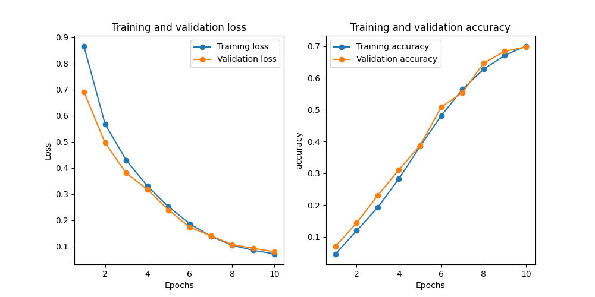

# IFT 780 - Devoir 4 - Segmentation d'images IRM cardiaques

Ce projet implémente des réseaux de neurones pour la segmentation d'images IRM cardiaques en quatre classes :
1. Fond
2. Ventricule droit
3. Myocarde
4. Ventricule gauche

## Fichiers modifiés

### Question 1 - Architectures

1. `src/models/YourUNet.py`
   - Nouvelle architecture basée sur UNet avec :
     - Convolutions séparables
     - Couches résiduelles
     - Blocs bottleneck

2. `src/models/YourSegNet.py`
   - Architecture non-symétrique inspirée de DeepLabV3 avec :
     - Encoder profond avec atrous convolutions et blocs résiduels
     - Decoder léger avec upsampling progressif et blocs denses
     - Skip connections asymétriques améliorées
     - Blocs bottleneck pour réduire les paramètres
     - Blocs résiduels pour faciliter l'apprentissage profond
     - Blocs denses pour une meilleure fusion des caractéristiques
     - Convolutions dilatées (atrous) pour capturer les contextes multi-échelles
     - Mécanisme de fusion optimisé pour les skip connections

3. `src/utils/losses.py`
   - Nouvelles fonctions de perte :
     - `DiceLoss` : Combine la perte Dice avec l'entropie croisée
     - `FocalLoss` : Gestion du déséquilibre des classes

4. `/train.py`
   - Ajout des nouveaux modèles dans les options
   - Intégration des nouvelles fonctions de perte
   - Support du dataset ACDC

### Question 2 - Checkpointing

1. `src/manage/CNNTrainTestManager.py`
   - Ajout du système de checkpointing
   - Sauvegarde automatique du meilleur modèle
   - Sauvegarde des checkpoints à chaque époque
   - Possibilité de charger un checkpoint existant

### Question 3 - Augmentation de données

1. `src/utils/augmentation.py`
   - Implémentation d'une classe d'augmentation avancée `ACDCJointTransform`
   - Utilise les transformations standard de torchvision
   - Gère la cohérence entre images et masques
   - Paramètres améliorés (rotation jusqu'à 60°, déformation plus marquée)

2. `train.py`
   - Intégration de la nouvelle classe d'augmentation
   - Migration des transformations personnalisées vers les standards torchvision
   - Amélioration des paramètres pour des effets plus visibles

3. `src/manage/CNNTrainTestManager.py`
   - Implémentation de la méthode `visualize_data_augmentation` pour visualiser les effets des augmentations
   - Mise à jour pour utiliser les nouvelles transformations de torchvision

## Commandes d'exécution

### Entraînement des modèles

1. YourUNet avec Dice Loss :
```bash
python train.py --model YourUNet --loss Dice --num-epochs 50 --batch_size 16 --lr 0.0001
```

2. YourSegNet avec Focal Loss :
```bash
python train.py --model YourSegNet --loss Focal --num-epochs 50 --batch_size 16 --lr 0.0001
```

### Prédiction avec un modèle entraîné
```bash
python train.py --model YourUNet --predict path/to/weights.pth
```

### Checkpointing
Les checkpoints sont automatiquement sauvegardés dans le dossier `checkpoints/` :
- `checkpoint_epoch_X.pth` : Checkpoint de chaque époque
- `best_model.pth` : Meilleur modèle selon la précision de validation

Pour charger un checkpoint spécifique :
```bash
python train.py --model YourUNet --checkpoint checkpoints/best_model.pth
```

Pour continuer l'entraînement à partir d'un checkpoint :
```bash
python train.py --model YourUNet --resume checkpoints/checkpoint_epoch_10.pth
```

### Augmentation de données
Pour activer les augmentations de données lors de l'entraînement, utilisez les options suivantes :

1. Rotation aléatoire (angle jusqu'à 60°) :
```bash
python train.py --model YourUNet --loss Dice --rotation
```

2. Déformation élastique (paramètres améliorés alpha=50.0, sigma=5.0) :
```bash
python train.py --model YourUNet --loss Dice --elastic
```

3. Les deux augmentations combinées :
```bash
python train.py --model YourUNet --loss Dice --rotation --elastic
```

4. Visualiser les effets des augmentations sur quelques images d'exemple :
```bash
python train.py --model YourUNet --visualize_augmentation --rotation --elastic
```

Les images générées pour l'analyse des augmentations sont sauvegardées dans le dossier `figures/` et montrent clairement les effets des transformations à la fois sur les images et sur les masques de segmentation.

## Description des techniques d'augmentation

### Transformations standard de torchvision
L'augmentation de données utilise maintenant les transformations standard de torchvision :
- `transforms.RandomRotation` pour la rotation aléatoire
- `transforms.ElasticTransform` pour la déformation élastique
- `transforms.RandomAffine` pour les transformations affines
- `transforms.RandomHorizontalFlip` pour le retournement horizontal
- `transforms.RandomVerticalFlip` pour le retournement vertical

### Classe ACDCJointTransform
Cette classe encapsule toutes les transformations et assure :
- La cohérence entre les images et leurs masques de segmentation
- La gestion automatique des formats d'entrée/sortie
- L'application des mêmes transformations aux paires image-masque
- La préservation de la qualité des images médicales

### Améliorations apportées
- Migration complète vers les transformations standard de torchvision
- Meilleure gestion de la mémoire et des performances
- Paramètres optimisés pour les images IRM cardiaques
- Structure modulaire facilitant l'ajout de nouvelles transformations
- Documentation claire des paramètres et effets des transformations

Ces améliorations permettent une augmentation de données plus robuste et efficace, tout en maintenant la qualité des images médicales.
### Résultats


## Description des nouvelles fonctions de perte

### Dice Loss
La perte Dice combine la perte Dice avec l'entropie croisée pour une meilleure stabilité :
- Calcule le coefficient de Dice pour chaque classe
- Combine avec l'entropie croisée standard
- Utile pour la segmentation car elle prend en compte le chevauchement entre les prédictions et les cibles

### Focal Loss
La perte Focal est conçue pour gérer le déséquilibre des classes :
- Réduit automatiquement le poids des exemples faciles
- Augmente le poids des exemples difficiles
- Paramètres ajustables (alpha et gamma) pour contrôler le focus

## Améliorations de l'architecture YourSegNet

L'architecture YourSegNet a été significativement améliorée avec plusieurs composants clés :

### Encoder amélioré
- Utilisation de blocs résiduels pour faciliter l'apprentissage profond
- Intégration de convolutions dilatées (atrous) pour capturer les contextes multi-échelles
- Blocs bottleneck pour réduire le nombre de paramètres tout en maintenant la capacité du modèle
- Structure hiérarchique avec downsampling progressif

### Decoder optimisé
- Blocs denses pour une meilleure fusion des caractéristiques
- Upsampling progressif avec convolutions transposées
- Skip connections asymétriques améliorées pour préserver les détails fins
- Mécanisme de fusion optimisé pour combiner les caractéristiques de différents niveaux

### Innovations architecturales
- Combinaison intelligente de blocs résiduels et denses
- Utilisation stratégique des convolutions atrous pour augmenter le champ réceptif
- Architecture non-symétrique pour une meilleure efficacité
- Pipeline de traitement optimisé pour la segmentation d'images IRM cardiaques

Ces améliorations permettent au modèle de :
- Capturer plus efficacement les caractéristiques multi-échelles
- Réduire le nombre de paramètres tout en maintenant la performance
- Améliorer la précision de segmentation des structures cardiaques
- Faciliter l'entraînement du réseau profond

## Courbes d'entraînement
[À remplir après l'entraînement des modèles]




