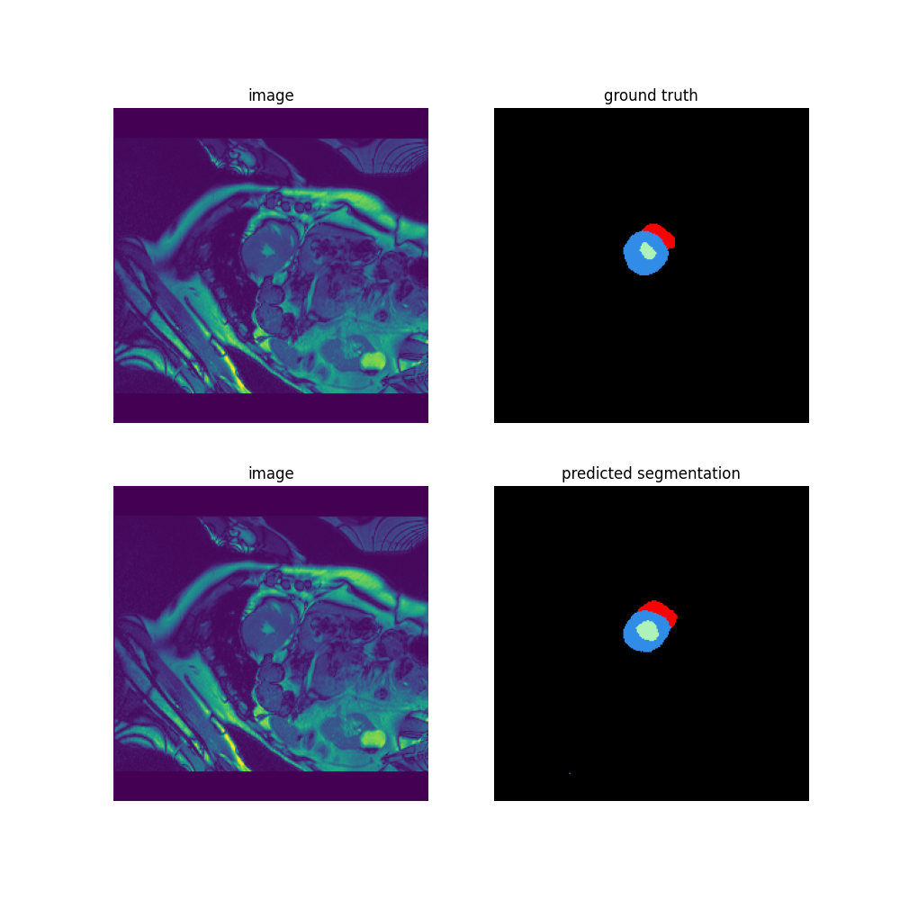
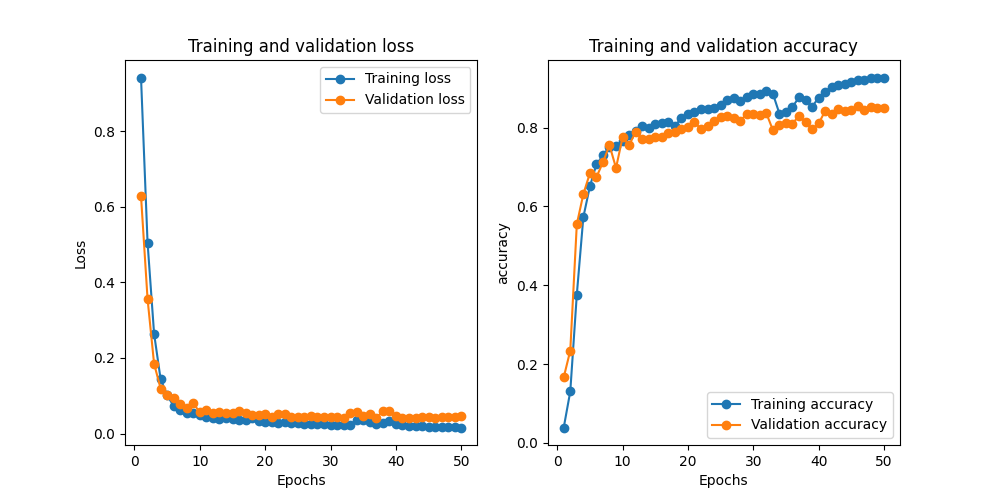
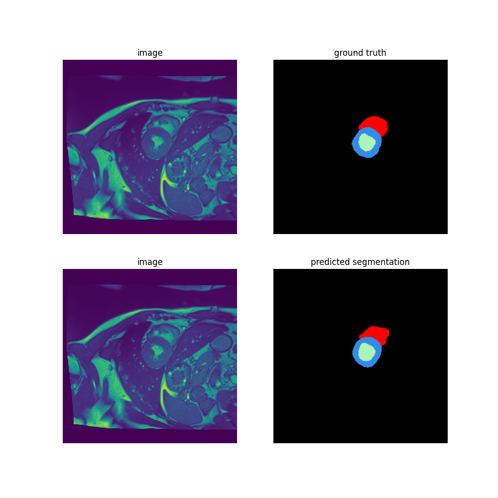
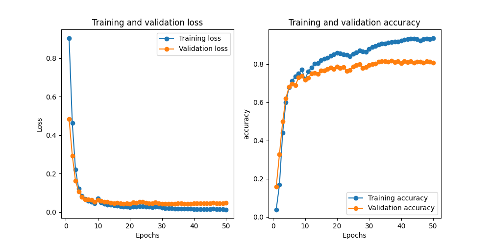
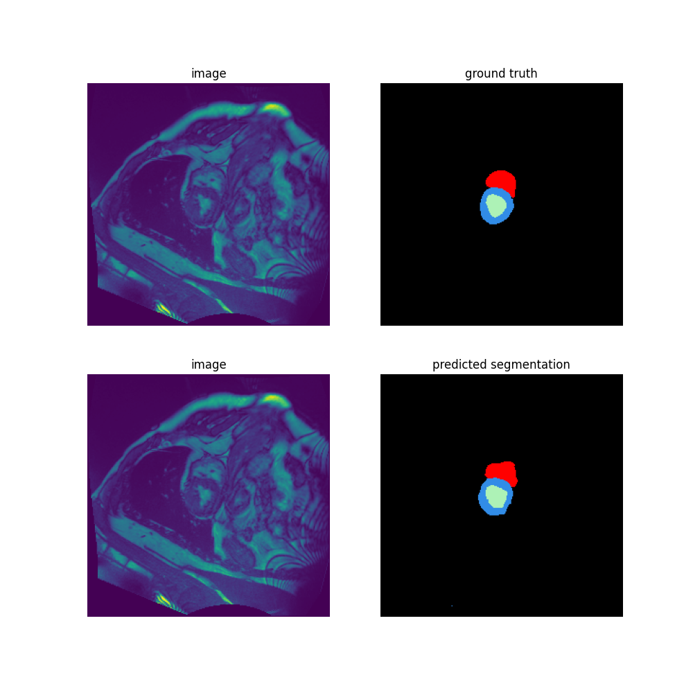

# Cardiac MRI Image Segmentation

Deep learning pipeline in PyTorch for the semantic segmentation of cardiac MRI slices
from the [ACDC dataset](https://www.creatis.insa-lyon.fr/Challenge/acdc/) into four classes:

| Class | Structure       |
|-------|-----------------|
| 0     | Background      |
| 1     | Right ventricle |
| 2     | Myocardium      |
| 3     | Left ventricle  |

The project compares a reference UNet with two custom architectures, `CustomUNet` and
`CustomSegNet`, and includes segmentation-specific losses, joint image/mask data
augmentation and a checkpointing system.



## Highlights

- **Two custom architectures** designed and trained from scratch
  - `CustomUNet`: a lightweight UNet (3.8M parameters) built on depthwise-separable convolutions
  - `CustomSegNet`: an asymmetric encoder-decoder (31.3M parameters) inspired by DeepLabV3,
    with atrous convolutions, residual blocks and dense fusion blocks
- **Segmentation losses**: combined Dice + cross-entropy loss and Focal loss
- **Data augmentation** applied consistently to images and masks (rotation, elastic deformation)
- **Checkpointing**: a checkpoint per epoch plus the best model according to the validation score
- **Evaluation** with the mean Dice score, training curves and prediction figures

## Results

Both models were trained for 50 epochs on ACDC. The score reported on the curves is the
mean Dice score over the classes.

| Model          | Parameters | Validation mean Dice (50 epochs) |
|----------------|-----------:|:--------------------------------:|
| `CustomUNet`   | 3.8M       | ≈ 0.81                           |
| `CustomSegNet` | 31.3M      | ≈ 0.85                           |

### CustomSegNet





### CustomUNet





## Architectures

### CustomUNet (`src/models/CustomUNet.py`)

A UNet variant that keeps the encoder-decoder structure and skip connections of the
original model while reducing its size:

- Depthwise-separable convolutions instead of standard convolutions
- Five-level encoder (32 to 512 channels) with batch normalization
- 1x1 bottleneck block between the encoder and the decoder
- Transposed convolutions for upsampling

### CustomSegNet (`src/models/CustomSegNet.py`)

An asymmetric architecture with a deep encoder and a lightweight decoder:

- **Encoder**: residual blocks with progressive downsampling, followed by atrous
  (dilated) bottleneck blocks that capture multi-scale context
- **Decoder**: progressive upsampling with transposed convolutions
- **Skip connections**: encoder features are merged in fusion blocks built around a
  dense block, which preserves fine details
- **Output**: bilinear upsampling back to the input resolution

Shared building blocks (`ResidualBlock`, `DenseBlock`, `BottleneckBlock`) live in
`src/models/CNNBlocks.py`.

## Project structure

```
├── train.py                        # Command-line entry point (training, prediction, visualization)
├── train.ipynb                     # Notebook walkthrough
├── requirements.txt
├── figures/                        # Training curves, predictions and augmentation examples
└── src/
    ├── manage/
    │   ├── CNNTrainTestManager.py  # Training loop, evaluation, checkpointing, plots
    │   ├── DataManager.py          # Train / validation / test data loaders
    │   └── HDF5Dataset.py          # ACDC dataset loader (HDF5)
    ├── models/
    │   ├── CustomUNet.py
    │   ├── CustomSegNet.py
    │   ├── UNet.py                 # Reference UNet
    │   ├── CNNBlocks.py            # Residual, dense and bottleneck blocks
    │   └── ...                     # Classification baselines (CnnVanilla, AlexNet, VggNet, ResNet)
    └── utils/
        ├── losses.py               # DiceLoss, FocalLoss
        ├── data_augmentation.py    # ACDCJointTransform
        └── utils.py                # Dice metric, resizing and visualization helpers
```

## Getting started

```bash
git clone https://github.com/lordyhas/medical-image-segmentation.git
cd medical-image-segmentation
pip install -r requirements.txt
```

The ACDC data is not distributed with this repository. The training script expects it
as an HDF5 file located at `data/ift780_acdc.hdf5`.

## Usage

### Training

CustomUNet with Dice loss:
```bash
python train.py --model CustomUNet --loss Dice --num-epochs 50 --batch_size 16 --lr 0.0001
```

CustomSegNet with Focal loss:
```bash
python train.py --model CustomSegNet --loss Focal --num-epochs 50 --batch_size 16 --lr 0.0001
```

Reference UNet:
```bash
python train.py --model UNet --num-epochs 50 --batch_size 16 --lr 0.0001
```

Run `python train.py --help` for the full list of options (optimizer, validation split,
`--max_samples` for quick tests, etc.).

### Checkpointing

Checkpoints are saved automatically in `checkpoints/<model>_<loss>/`:

- `checkpoint_epoch_<N>_<model>.pth`: checkpoint of each epoch
- `best_model_<model>.pth`: best model according to the validation score

### Prediction with a trained model

```bash
python train.py --model CustomUNet --loss Dice --predict checkpoints/CustomUNet_Dice/best_model_CustomUNet.pth
```

The predicted masks are saved in `figures/` next to the image and its ground truth.

### Data augmentation

Random rotation (up to 60°):
```bash
python train.py --model CustomUNet --loss Dice --rotation
```

Elastic deformation (alpha=50.0, sigma=5.0):
```bash
python train.py --model CustomUNet --loss Dice --elastic
```

Both combined:
```bash
python train.py --model CustomUNet --loss Dice --rotation --elastic
```

Visualize the effect of the augmentations on a few samples:
```bash
python train.py --model CustomUNet --visualize_augmentation --rotation --elastic
```


The augmentations are implemented by the `ACDCJointTransform` class
(`src/utils/data_augmentation.py`) on top of standard torchvision transforms
(`RandomRotation`, `ElasticTransform`). The same random transformation is applied to an
image and its segmentation mask so that they stay aligned.

## Loss functions

Implemented in `src/utils/losses.py`.

### Dice loss

Combines the Dice loss with cross-entropy for better stability:

- Computes the Dice coefficient of each class from the softmax probabilities
- Averages it with the standard cross-entropy
- Well suited to segmentation because it directly measures the overlap between
  predictions and targets

### Focal loss

Designed to handle class imbalance (the background dominates cardiac MRI slices):

- Reduces the weight of easy examples and increases the weight of difficult ones
- Adjustable `alpha` and `gamma` parameters to control the focus

## Acknowledgments

This project started as part of a graduate deep learning course at the Université de
Sherbrooke. The base training framework and the reference models were provided by
Prof. Pierre-Marc Jodoin; the custom architectures, loss functions, data augmentation and
checkpointing were developed on top of it.

## Author

**Hassan Kajila** — [GitHub](https://github.com/lordyhas)
