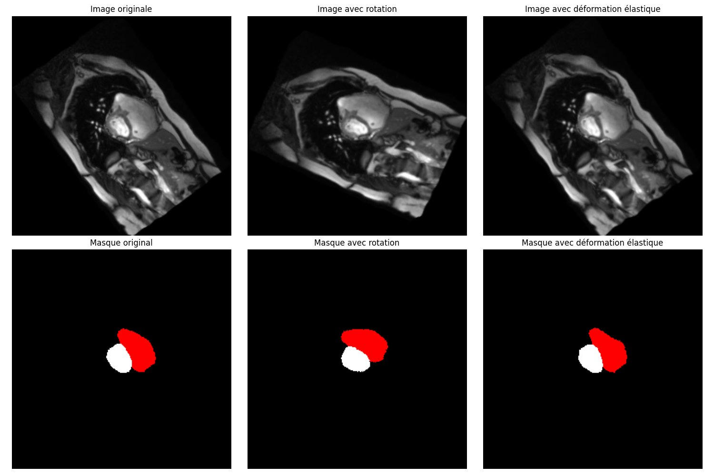

# Cardiac MRI Image Segmentation

This project implements neural networks for the segmentation of cardiac MRI images into four classes:
1. Background
2. Right ventricle
3. Myocardium
4. Left ventricle

## Modified files

### Question 1 - Architectures

1. `src/models/YourUNet.py`
   - New UNet-based architecture with:
     - Separable convolutions
     - Residual layers
     - Bottleneck blocks

2. `src/models/YourSegNet.py`
   - Asymmetric architecture inspired by DeepLabV3 with:
     - Deep encoder with atrous convolutions and residual blocks
     - Lightweight decoder with progressive upsampling and dense blocks
     - Improved asymmetric skip connections
     - Bottleneck blocks to reduce parameters
     - Residual blocks to facilitate deep learning
     - Dense blocks for better feature fusion
     - Dilated (atrous) convolutions to capture multi-scale context
     - Optimized fusion mechanism for skip connections

3. `src/utils/losses.py`
   - New loss functions:
     - `DiceLoss`: Combines Dice loss with cross-entropy
     - `FocalLoss`: Handles class imbalance

4. `/train.py`
   - Added new models to the options
   - Integrated the new loss functions
   - Added ACDC dataset support

### Question 2 - Checkpointing

1. `src/manage/CNNTrainTestManager.py`
   - Added checkpointing system
   - Automatic saving of the best model
   - Saving checkpoints at every epoch
   - Ability to load an existing checkpoint

### Question 3 - Data Augmentation

1. `src/utils/augmentation.py`
   - Implementation of the advanced augmentation class `ACDCJointTransform`
   - Uses standard torchvision transformations
   - Maintains consistency between images and masks
   - Improved parameters (rotation up to 60°, stronger deformation)

2. `train.py`
   - Integrated the new augmentation class
   - Migrated custom transforms to standard torchvision transforms
   - Improved parameters for more visible effects

3. `src/manage/CNNTrainTestManager.py`
   - Implemented the `visualize_data_augmentation` method to visualize augmentation effects
   - Updated to use the new torchvision transformations

## Execution commands

### Model training

1. YourUNet with Dice Loss:
```bash
python train.py --model YourUNet --loss Dice --num-epochs 50 --batch_size 16 --lr 0.0001
```

2. YourSegNet with Focal Loss:
```bash
python train.py --model YourSegNet --loss Focal --num-epochs 50 --batch_size 16 --lr 0.0001
```

### Prediction with a trained model
```bash
python train.py --model YourUNet --predict path/to/weights.pth
```

### Checkpointing
Checkpoints are automatically saved in the `checkpoints/` folder:
- `checkpoint_epoch_X.pth`: Checkpoint for each epoch
- `best_model.pth`: Best model according to validation accuracy

To load a specific checkpoint:
```bash
python train.py --model YourUNet --checkpoint checkpoints/best_model.pth
```

To continue training from a checkpoint:
```bash
python train.py --model YourUNet --resume checkpoints/checkpoint_epoch_10.pth
```

### Data augmentation
To enable data augmentation during training, use the following options:

1. Random rotation (angle up to 60°):
```bash
python train.py --model YourUNet --loss Dice --rotation
```

2. Elastic deformation (improved parameters alpha=50.0, sigma=5.0):
```bash
python train.py --model YourUNet --loss Dice --elastic
```

3. Both augmentations combined:
```bash
python train.py --model YourUNet --loss Dice --rotation --elastic
```

4. Visualize the augmentation effects on a few sample images:
```bash
python train.py --model YourUNet --visualize_augmentation --rotation --elastic
```

The generated images for augmentation analysis are saved in the `figures/` folder and clearly show the effects of transformations on both the images and the segmentation masks.

## Description of augmentation techniques

### Standard torchvision transformations
Data augmentation now uses standard torchvision transforms:
- `transforms.RandomRotation` for random rotation
- `transforms.ElasticTransform` for elastic deformation
- `transforms.RandomAffine` for affine transformations
- `transforms.RandomHorizontalFlip` for horizontal flipping
- `transforms.RandomVerticalFlip` for vertical flipping

### ACDCJointTransform class
This class encapsulates all transformations and ensures:
- Consistency between images and their segmentation masks
- Automatic handling of input/output formats
- Applying the same transformations to image-mask pairs
- Preservation of the quality of medical images

### Improvements made
- Full migration to standard torchvision transformations
- Better memory management and performance
- Optimized parameters for cardiac MRI images
- Modular structure that facilitates adding new transformations
- Clear documentation of parameters and transformation effects

These improvements enable a more robust and efficient data augmentation pipeline while maintaining the quality of medical images.

### Results


## Description of the new loss functions

### Dice Loss
Dice loss combines Dice loss with cross-entropy for better stability:
- Computes the Dice coefficient for each class
- Combines it with standard cross-entropy
- Useful for segmentation because it accounts for overlap between predictions and targets

### Focal Loss
Focal loss is designed to handle class imbalance:
- Automatically reduces the weight of easy examples
- Increases the weight of difficult examples
- Adjustable parameters (alpha and gamma) to control the focus

## Improvements to the YourSegNet architecture

The YourSegNet architecture has been significantly improved with several key components:

### Improved encoder
- Use of residual blocks to facilitate deep learning
- Integration of dilated (atrous) convolutions to capture multi-scale context
- Bottleneck blocks to reduce the number of parameters while maintaining capacity
- Hierarchical structure with progressive downsampling

### Optimized decoder
- Dense blocks for better feature fusion
- Progressive upsampling with transposed convolutions
- Improved asymmetric skip connections to preserve fine details
- Optimized fusion mechanism to combine features from different levels

### Architectural innovations
- Intelligent combination of residual and dense blocks
- Strategic use of atrous convolutions to increase the receptive field
- Asymmetric architecture for better efficiency
- Optimized processing pipeline for cardiac MRI image segmentation

These improvements allow the model to:
- Capture multi-scale features more effectively
- Reduce the number of parameters while maintaining performance
- Improve segmentation accuracy of cardiac structures
- Facilitate training of the deep network

## Training curves
[To be filled after training the models]
### YourSegNet

### YourUNet


