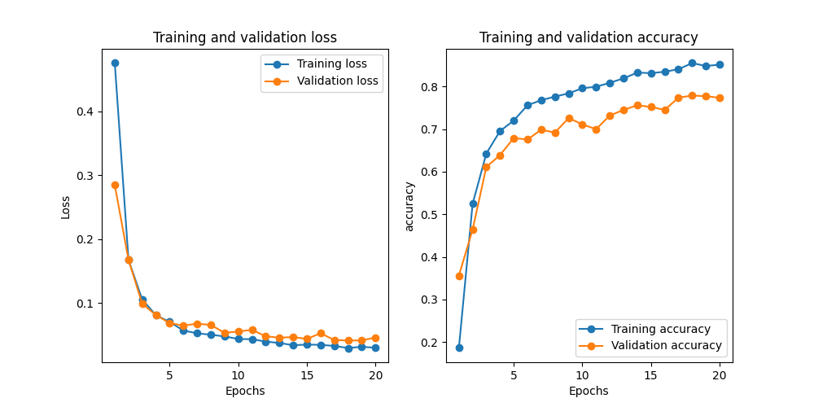

# IFT 780 - Devoir 4 - Segmentation d'images IRM cardiaques

Ce projet implémente des réseaux de neurones pour la segmentation d'images IRM cardiaques en quatre classes :
1. Fond
2. Ventricule droit
3. Myocarde
4. Ventricule gauche

## Fichiers modifiés

### Question 1 - Architectures

1. `src/models/YourUNet.py`
   - Nouvelle architecture basée sur UNet avec :
     - Convolutions séparables
     - Couches résiduelles
     - Blocs bottleneck

2. `src/models/YourSegNet.py`
   - Architecture non-symétrique inspirée de DeepLabV3 avec :
     - Encoder profond avec atrous convolutions
     - Decoder léger avec upsampling progressif
     - Skip connections asymétriques

3. `src/utils/losses.py`
   - Nouvelles fonctions de perte :
     - `DiceLoss` : Combine la perte Dice avec l'entropie croisée
     - `FocalLoss` : Gestion du déséquilibre des classes

4. `/train.py`
   - Ajout des nouveaux modèles dans les options
   - Intégration des nouvelles fonctions de perte
   - Support du dataset ACDC

### Question 2 - Checkpointing

1. `src/manage/CNNTrainTestManager.py`
   - Ajout du système de checkpointing
   - Sauvegarde automatique du meilleur modèle
   - Sauvegarde des checkpoints à chaque époque
   - Possibilité de charger un checkpoint existant

### Question 3 - Augmentation de données

1. `src/utils/augmentation.py`
   - Implémentation d'une classe d'augmentation avancée `ACDCJointTransform`
   - Utilise les transformations standard de torchvision
   - Gère la cohérence entre images et masques
   - Paramètres améliorés (rotation jusqu'à 60°, déformation plus marquée)

2. `train.py`
   - Intégration de la nouvelle classe d'augmentation
   - Migration des transformations personnalisées vers les standards torchvision
   - Amélioration des paramètres pour des effets plus visibles

3. `src/utils/data_augmentation.py`
   - Implémentation initiale des deux techniques d'augmentation:
     - `SimpleRandomRotation` : Rotation aléatoire des images et masques
     - `SimpleElasticDeformation` : Déformation élastique pour simuler des variations anatomiques

4. `src/manage/HDF5Dataset.py`
   - Intégration des méthodes d'augmentation dans le pipeline de chargement de données
   - Implémentation de `apply_random_rotation` et `apply_elastic_deformation`
   - Conservation de la cohérence entre images et masques correspondants

5. `src/manage/CNNTrainTestManager.py`
   - Implémentation de la méthode `visualize_data_augmentation` pour visualiser les effets des augmentations
   - Mise à jour pour utiliser les nouvelles transformations de torchvision

## Commandes d'exécution

### Entraînement des modèles

1. YourUNet avec Dice Loss :
```bash
python train.py --model YourUNet --loss Dice --num-epochs 50 --batch_size 16 --lr 0.0001
```

2. YourSegNet avec Focal Loss :
```bash
python train.py --model YourSegNet --loss Focal --num-epochs 50 --batch_size 16 --lr 0.0001
```

### Prédiction avec un modèle entraîné
```bash
python train.py --model YourUNet --predict path/to/weights.pth
```

### Checkpointing
Les checkpoints sont automatiquement sauvegardés dans le dossier `checkpoints/` :
- `checkpoint_epoch_X.pth` : Checkpoint de chaque époque
- `best_model.pth` : Meilleur modèle selon la précision de validation

Pour charger un checkpoint spécifique :
```bash
python train.py --model YourUNet --checkpoint checkpoints/best_model.pth
```

Pour continuer l'entraînement à partir d'un checkpoint :
```bash
python train.py --model YourUNet --resume checkpoints/checkpoint_epoch_10.pth
```

### Augmentation de données
Pour activer les augmentations de données lors de l'entraînement, utilisez les options suivantes :

1. Rotation aléatoire (angle jusqu'à 60°) :
```bash
python train.py --model YourUNet --loss Dice --rotation
```

2. Déformation élastique (paramètres améliorés alpha=50.0, sigma=5.0) :
```bash
python train.py --model YourUNet --loss Dice --elastic
```

3. Les deux augmentations combinées :
```bash
python train.py --model YourUNet --loss Dice --rotation --elastic
```

4. Visualiser les effets des augmentations sur quelques images d'exemple :
```bash
python train.py --model YourUNet --visualize_augmentation --rotation --elastic
```

Les images générées pour l'analyse des augmentations sont sauvegardées dans le dossier `figures/` et montrent clairement les effets des transformations à la fois sur les images et sur les masques de segmentation.

## Description des techniques d'augmentation

### Rotation aléatoire
Cette technique applique une rotation aléatoire à l'image et à son masque de segmentation correspondant :
- Angle de rotation aléatoire dans la plage [-60°, 60°] (paramètre amélioré)
- Utilisation de la même graine aléatoire pour l'image et le masque pour maintenir la cohérence
- Implémentée via la fonction `functional.rotate()` de torchvision
- Interpolation bilinéaire pour une meilleure qualité d'image

### Déformation élastique
Cette technique simule des variations anatomiques par déformation élastique non linéaire :
- Génère un champ de déplacement aléatoire
- Applique un filtre gaussien pour lisser les déplacements
- Paramètres optimisés : α=50.0 (amplitude) et σ=5.0 (lissage)
- Utilise la classe `ElasticTransform` de torchvision quand disponible
- Mise en œuvre robuste qui préserve la cohérence entre image et masque

### Améliorations apportées
- Migration des transformations personnalisées vers les standards de torchvision
- Encapsulation dans une classe modulaire `ACDCJointTransform`
- Gestion automatique des formats d'entrée/sortie (numpy/tenseur)
- Paramètres ajustés pour des effets plus visibles et efficaces
- Structure de code modulaire permettant une maintenance et extension faciles

Ces techniques améliorent significativement la capacité de généralisation des modèles, en particulier lorsque la quantité de données d'entraînement est limitée.

## Résultats


## Description des nouvelles fonctions de perte

### Dice Loss
La perte Dice combine la perte Dice avec l'entropie croisée pour une meilleure stabilité :
- Calcule le coefficient de Dice pour chaque classe
- Combine avec l'entropie croisée standard
- Utile pour la segmentation car elle prend en compte le chevauchement entre les prédictions et les cibles

### Focal Loss
La perte Focal est conçue pour gérer le déséquilibre des classes :
- Réduit automatiquement le poids des exemples faciles
- Augmente le poids des exemples difficiles
- Paramètres ajustables (alpha et gamma) pour contrôler le focus


## Courbes d'entraînement
[À remplir après l'entraînement des modèles]



